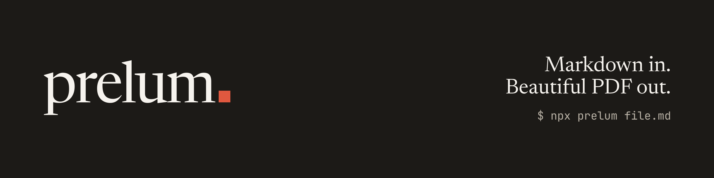
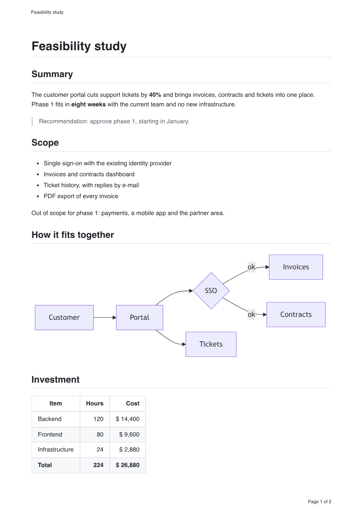
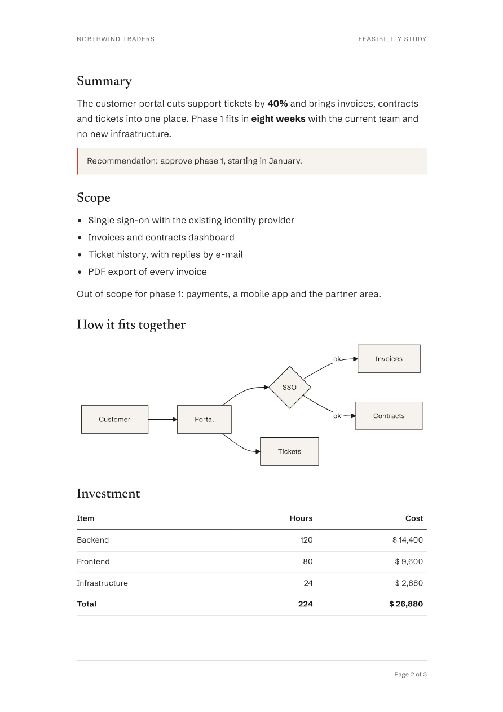
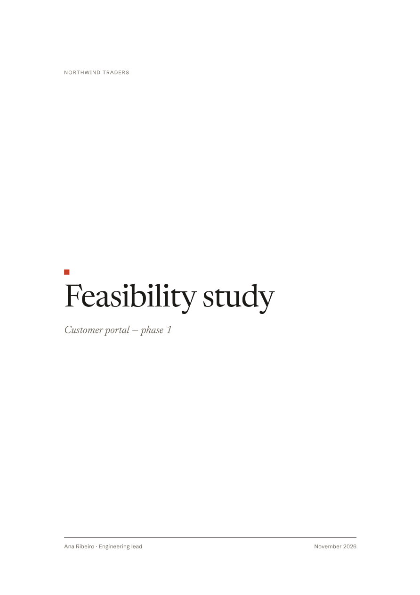
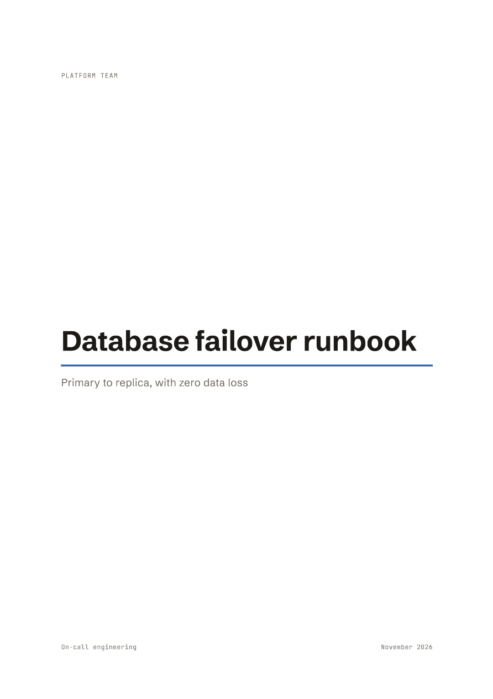
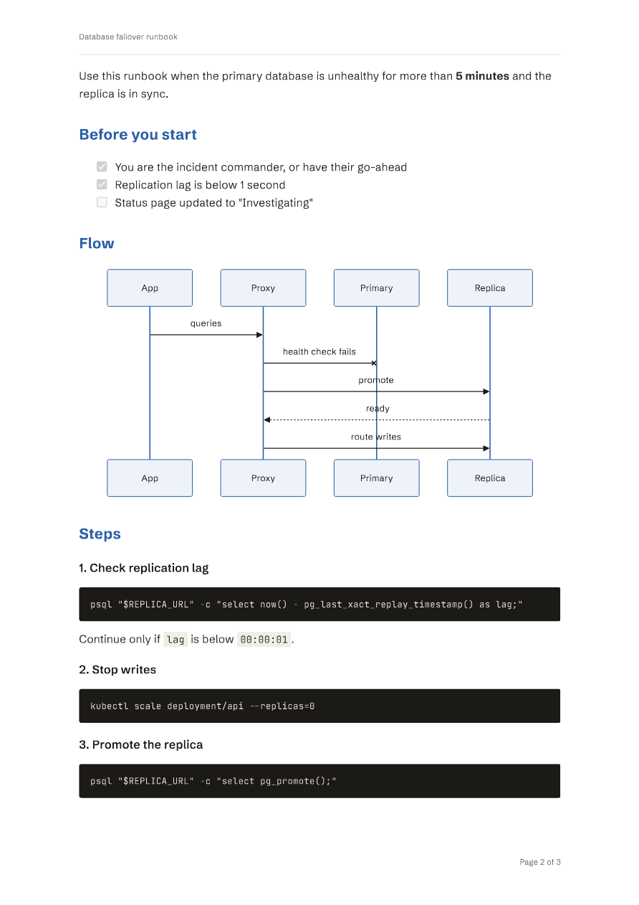

<p align="center">
  
</p>

<p align="center">
  <a href="https://www.npmjs.com/package/prelum"></a>
  <a href="https://github.com/prelum/prelum/actions/workflows/ci.yml"></a>
  <a href="LICENSE"></a>
</p>

<p align="center"><b>English</b> · <a href="README.pt-BR.md">Português</a></p>

Prelum turns Markdown into PDFs that look designed: a cover, running headers, "Page 2 of 4", Mermaid diagrams and tables that break cleanly across pages. You pick a theme in the frontmatter and never write CSS. It works offline: fonts, diagrams and themes ship inside the package, and nothing leaves your machine.

```sh
npx prelum report.md
```

## Before and after

The same Markdown file, printed with GitHub's stylesheet and with Prelum's `report` theme.

<table>
  <tr>
    <td width="50%"></td>
    <td width="50%"></td>
  </tr>
  <tr>
    <td align="center">GitHub Markdown CSS</td>
    <td align="center"><code>prelum</code> · <code>report</code> theme</td>
  </tr>
</table>

## Quick start

```sh
npx prelum report.md                                # report.pdf, next to the file
npx prelum docs/*.md --theme technical --out dist/  # many files, one folder
npx prelum themes                                   # list the themes
```

Prelum needs Node 22 or later and a Chromium-based browser: it uses the Chrome or Edge you already have, so nothing large is downloaded. With neither installed, run `npx playwright install chromium` once.

```
  prelum■ 0.2.0

  ✓ markdown    157 words
  ✓ mermaid     1 diagram
  ✓ theme       report
  ✓ pages       cover, 3 pages

  ■ report.pdf ready in 0.9 s
```

## Themes

<table>
  <tr>
    <th>Theme</th>
    <th>For</th>
    <th>Cover</th>
    <th>Inside</th>
  </tr>
  <tr>
    <td><code>report</code><br>(default)</td>
    <td>Proposals, feasibility studies, consulting reports</td>
    <td width="25%"><a href="examples/feasibility-study.pdf"></a></td>
    <td width="25%"><a href="examples/feasibility-study.pdf"></a></td>
  </tr>
  <tr>
    <td><code>technical</code></td>
    <td>Documentation, implementation reports, runbooks</td>
    <td><a href="examples/runbook.pdf"></a></td>
    <td><a href="examples/runbook.pdf"></a></td>
  </tr>
</table>

Each image links to the full PDF. The sources are in [`examples/`](examples/).

## Frontmatter

Everything is set at the top of the Markdown file. All fields are optional.

```yaml
---
title: Feasibility study        # cover and headers; defaults to the first # heading
subtitle: Customer portal — phase 1
client: Northwind Traders       # top of the cover and of every page (report)
author: Ana Ribeiro
date: 2026-11-17                # printed as "November 2026"; "auto" means today
theme: report                   # report | technical
cover: true
lang: en                        # en | pt: "Page 2 of 4" or "Página 2 de 4", and the date
---
```

## Options

| Option | Default | |
|---|---|---|
| `-t, --theme <name>` | `report` | Theme. Wins over the frontmatter |
| `-o, --out <path>` | next to the `.md` | Output file (`.pdf`) or folder |
| `--format <A4\|Letter>` | `A4` | Paper size |
| `--cover`, `--no-cover` | from the frontmatter | With or without a cover |
| `--css <file>` | | Extra CSS after the theme, for the rare case a theme is not enough |
| `--html` | | Also save the intermediate HTML |
| `--lang <en\|pt>` | from `LANG` | Language of the terminal messages |

Exit codes: `0` done · `1` input error (file, theme, frontmatter) · `2` render error · `3` no browser found.

Set [`SOURCE_DATE_EPOCH`](https://reproducible-builds.org/docs/source-date-epoch/) to stamp a fixed date in the PDF: the same file then prints the same bytes with the same browser version, which keeps generated PDFs stable in git. A different Chrome version can break lines differently; pinning the browser is tracked in [#15](https://github.com/prelum/prelum/issues/15).

## How it works

Markdown goes through [unified](https://unifiedjs.com) (remark and rehype) to HTML. The theme stylesheet, the bundled fonts and the page setup are added, and a headless Chromium prints the page: CSS page margin boxes draw the headers and footers, and Mermaid draws the diagrams in the theme's colors.

## Contributing and support

Issues and pull requests are welcome: the [contributing guide](https://github.com/prelum/.github/blob/main/CONTRIBUTING.md) explains the setup and the checks. If prelum saves you time, you can support it on [GitHub Sponsors](https://github.com/sponsors/Fransuelton).

## License

[MIT](LICENSE). The bundled fonts, Newsreader, Schibsted Grotesk and JetBrains Mono, are under the [SIL Open Font License](fonts/newsreader/OFL.txt).
