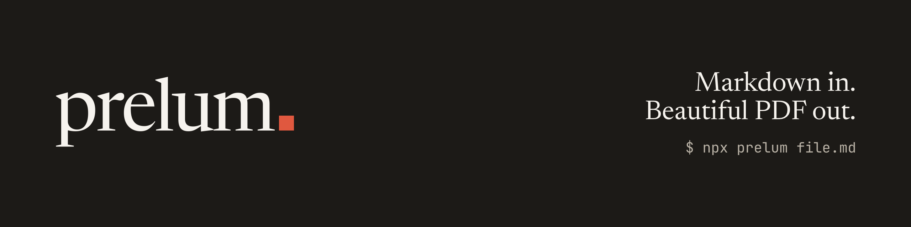
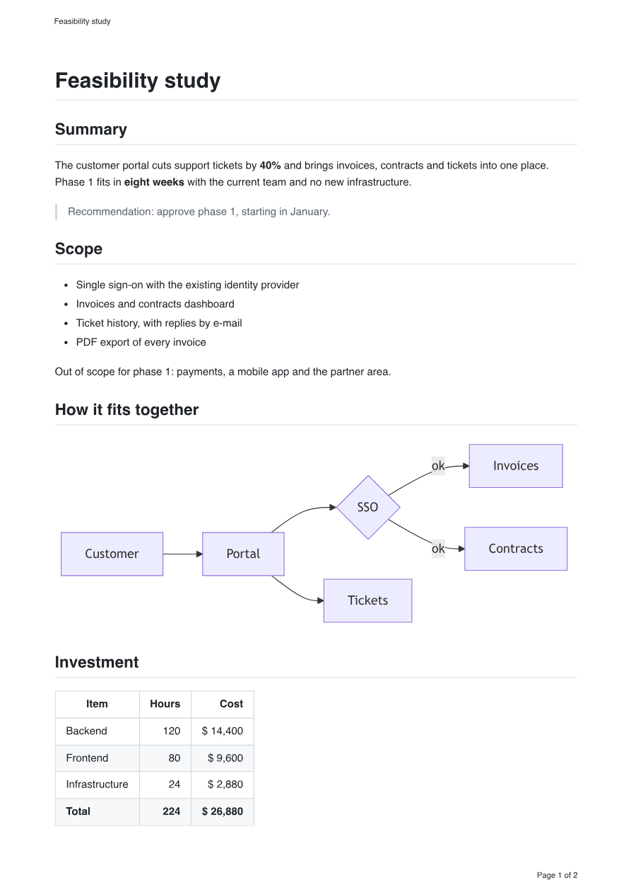
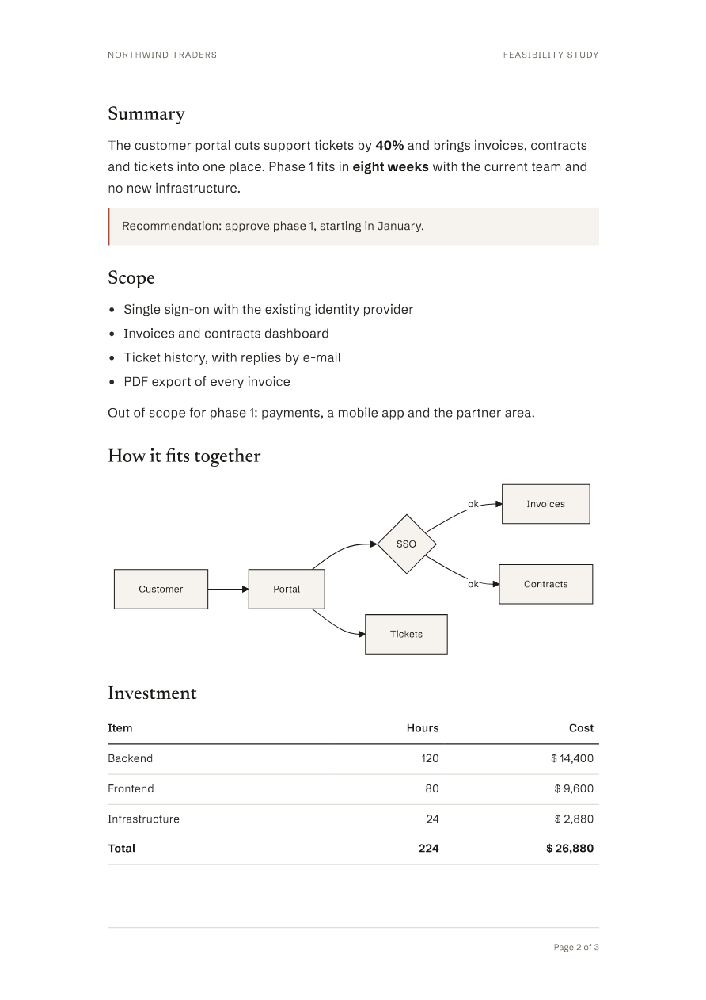
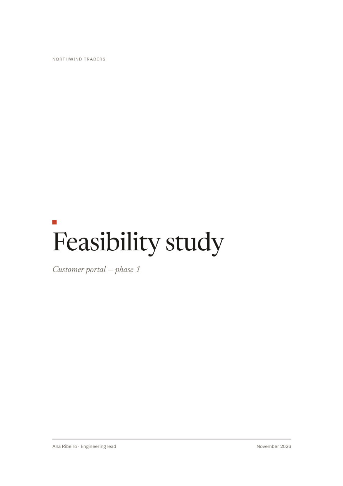
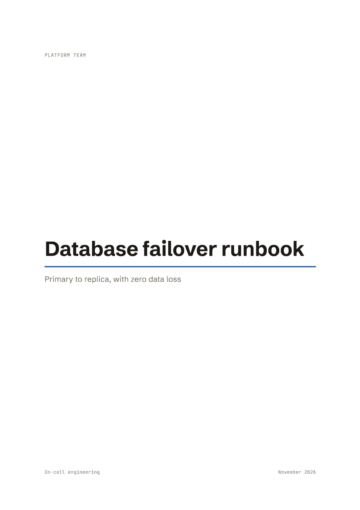
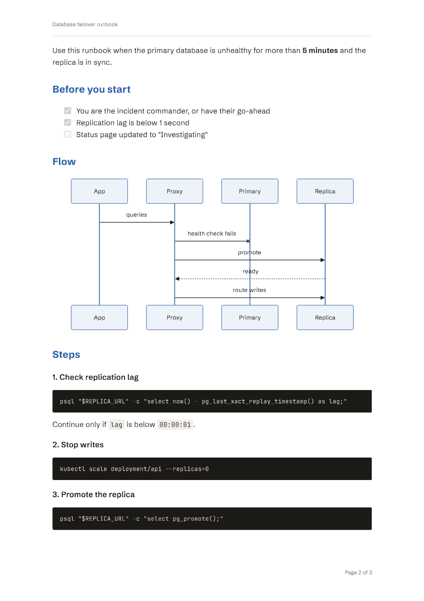

<p align="center">
  
</p>

<p align="center">
  <a href="https://www.npmjs.com/package/prelum"></a>
  <a href="https://github.com/prelum/prelum/actions/workflows/ci.yml"></a>
  <a href="LICENSE"></a>
</p>

<p align="center"><a href="README.md">English</a> · <b>Português</b></p>

O Prelum transforma Markdown em PDFs com cara de documento diagramado: capa, cabeçalho e rodapé, "Página 2 de 4", diagramas Mermaid e tabelas que quebram bem entre páginas. Você escolhe um tema no frontmatter e nunca escreve CSS. Funciona offline: fontes, diagramas e temas vêm dentro do pacote, e nada sai da sua máquina.

```sh
npx prelum relatorio.md
```

## Antes e depois

O mesmo arquivo Markdown, impresso com a folha de estilo do GitHub e com o tema `report` do Prelum.

<table>
  <tr>
    <td width="50%"></td>
    <td width="50%"></td>
  </tr>
  <tr>
    <td align="center">CSS de Markdown do GitHub</td>
    <td align="center"><code>prelum</code> · tema <code>report</code></td>
  </tr>
</table>

## Começando

```sh
npx prelum relatorio.md                             # relatorio.pdf, ao lado do arquivo
npx prelum docs/*.md --theme technical --out dist/  # vários arquivos, uma pasta
npx prelum themes                                   # lista os temas
```

O Prelum precisa do Node 22 ou mais novo e de um navegador baseado em Chromium: ele usa o Chrome ou o Edge que você já tem, então nada grande é baixado. Sem nenhum dos dois, rode uma vez `npx playwright install chromium`.

```
  prelum■ 0.1.0

  ✓ markdown    157 palavras
  ✓ mermaid     1 diagrama
  ✓ tema        report
  ✓ paginação   capa, 3 páginas

  ■ relatorio.pdf pronto em 0,9 s
```

As mensagens saem em português quando o `LANG` do terminal começa com `pt`, ou com `--lang pt`.

## Temas

<table>
  <tr>
    <th>Tema</th>
    <th>Para</th>
    <th>Capa</th>
    <th>Miolo</th>
  </tr>
  <tr>
    <td><code>report</code><br>(padrão)</td>
    <td>Propostas, estudos de viabilidade, relatórios de consultoria</td>
    <td width="25%"><a href="examples/feasibility-study.pdf"></a></td>
    <td width="25%"><a href="examples/feasibility-study.pdf"></a></td>
  </tr>
  <tr>
    <td><code>technical</code></td>
    <td>Documentação, relatórios de implementação, runbooks</td>
    <td><a href="examples/runbook.pdf"></a></td>
    <td><a href="examples/runbook.pdf"></a></td>
  </tr>
</table>

Cada imagem leva ao PDF completo. Sem capa, o documento começa direto no conteúdo: veja as [notas de reunião](examples/notas-de-reuniao.pdf). Os fontes estão em [`examples/`](examples/).

## Frontmatter

Tudo se configura no topo do arquivo Markdown. Todos os campos são opcionais.

```yaml
---
title: Estudo de viabilidade    # capa e cabeçalhos; o padrão é o primeiro título #
subtitle: Portal do Cliente — fase 1
client: Acme Ltda               # topo da capa e de cada página (report)
author: Ana Ribeiro
date: 2026-11-17                # impresso como "novembro de 2026"; "auto" é hoje
theme: report                   # report | technical
cover: true
lang: pt                        # en | pt: "Página 2 de 4" ou "Page 2 of 4", e a data
---
```

## Opções

| Opção | Padrão | |
|---|---|---|
| `-t, --theme <nome>` | `report` | Tema. Vence o frontmatter |
| `-o, --out <caminho>` | ao lado do `.md` | Arquivo (`.pdf`) ou pasta de saída |
| `--format <A4\|Letter>` | `A4` | Tamanho do papel |
| `--cover`, `--no-cover` | do frontmatter | Com ou sem capa |
| `--css <arquivo>` | | CSS extra depois do tema, para o caso raro em que o tema não basta |
| `--html` | | Salva também o HTML intermediário |
| `--lang <en\|pt>` | do `LANG` | Idioma das mensagens no terminal |

Códigos de saída: `0` pronto · `1` erro de entrada (arquivo, tema, frontmatter) · `2` erro ao gerar · `3` nenhum navegador encontrado.

Defina [`SOURCE_DATE_EPOCH`](https://reproducible-builds.org/docs/source-date-epoch/) para gravar uma data fixa no PDF: o mesmo arquivo passa a gerar os mesmos bytes, o que deixa PDFs gerados estáveis no git.

## Como funciona

O Markdown passa pelo [unified](https://unifiedjs.com) (remark e rehype) e vira HTML. Entram a folha de estilo do tema, as fontes embutidas e a configuração da página, e um Chromium sem interface imprime: as margin boxes do CSS de página desenham cabeçalho e rodapé, e o Mermaid desenha os diagramas nas cores do tema.

## Contribuir e apoiar

Issues e pull requests são bem-vindos: o [guia de contribuição](https://github.com/prelum/.github/blob/main/CONTRIBUTING.md) (em inglês) explica o ambiente e as verificações. Se o prelum economiza o seu tempo, dá para apoiar pelo [GitHub Sponsors](https://github.com/sponsors/Fransuelton).

## Licença

[MIT](LICENSE). As fontes embutidas, Newsreader, Schibsted Grotesk e JetBrains Mono, estão sob a [SIL Open Font License](fonts/newsreader/OFL.txt).
