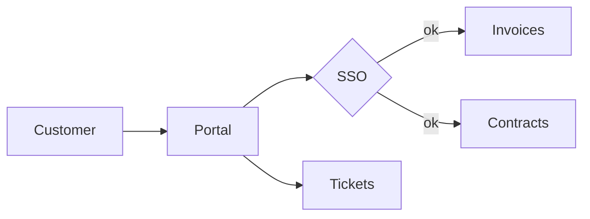

# Feasibility study

## Summary

The customer portal cuts support tickets by **40%** and brings invoices, contracts and tickets into one place. Phase 1 fits in **eight weeks** with the current team and no new infrastructure.

> Recommendation: approve phase 1, starting in January.

## Scope

- Single sign-on with the existing identity provider
- Invoices and contracts dashboard
- Ticket history, with replies by e-mail
- PDF export of every invoice

Out of scope for phase 1: payments, a mobile app and the partner area.

## How it fits together

## Investment

| Item | Hours | Cost |
|---|--:|--:|
| Backend | 120 | $ 14,400 |
| Frontend | 80 | $ 9,600 |
| Infrastructure | 24 | $ 2,880 |
| **Total** | **224** | **$ 26,880** |

## Risks

| Risk | Likelihood | Mitigation |
|---|---|---|
| Identity provider limits | Low | Confirmed quotas with the vendor in week 1 |
| Invoice data quality | Medium | Clean-up script before the import |
| Team availability in December | Medium | Phase starts in January |

## Next steps

1. Approve the budget with finance.
2. Book the testing window with the customer team.
3. Start week 1 on January 6.
