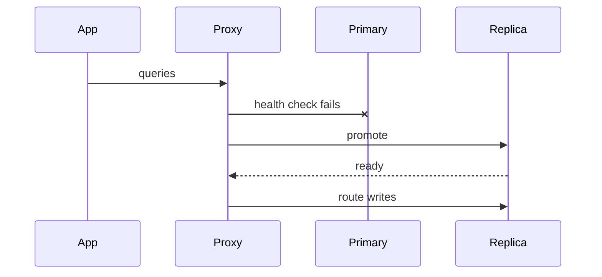

# Database failover runbook

Use this runbook when the primary database is unhealthy for more than **5 minutes** and the replica is in sync.

## Before you start

- [x] You are the incident commander, or have their go-ahead
- [x] Replication lag is below 1 second
- [ ] Status page updated to "Investigating"

## Flow



## Steps

### 1. Check replication lag

```bash
psql "$REPLICA_URL" -c "select now() - pg_last_xact_replay_timestamp() as lag;"
```

Continue only if `lag` is below `00:00:01`.

### 2. Stop writes

```bash
kubectl scale deployment/api --replicas=0
```

### 3. Promote the replica

```bash
psql "$REPLICA_URL" -c "select pg_promote();"
```

### 4. Point the proxy to the new primary

```yaml
# proxy/config.yaml
primary: replica-1.db.internal:5432
```

### 5. Restore writes

```bash
kubectl scale deployment/api --replicas=6
```

## Reference

| Signal | Healthy | Act when |
|---|--:|--:|
| Replication lag | < 100 ms | > 1 s |
| Connections | < 400 | > 480 |
| Disk used | < 70% | > 85% |

> After the incident, open a post-mortem within 48 hours and link it here.
